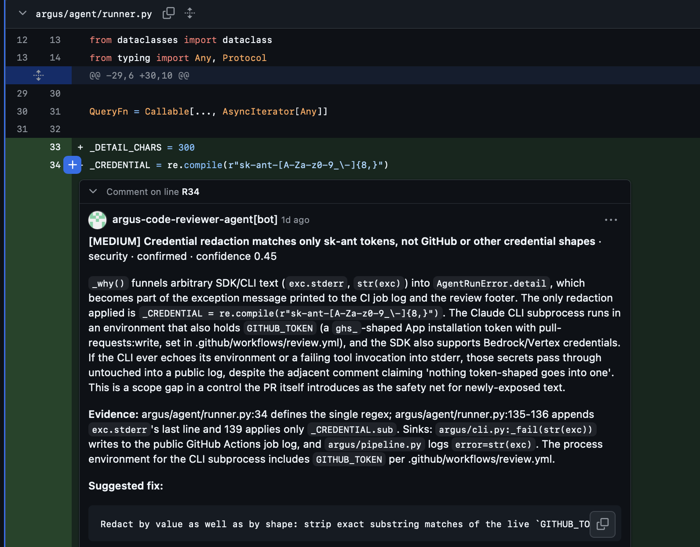
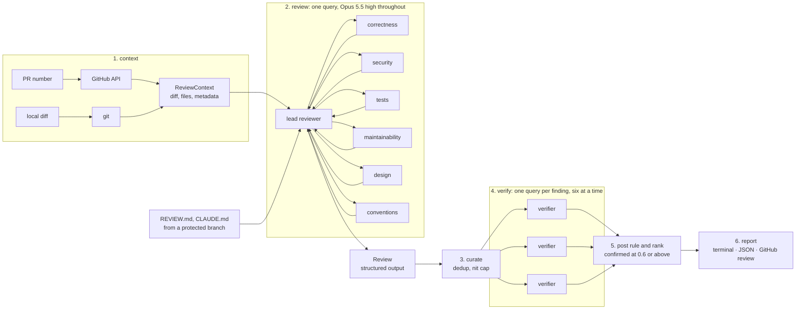

# Argus

[](https://github.com/hamseabd/argus/actions/workflows/ci.yml)

Argus is a multi-agent code-review harness built on the [Claude Agent SDK](https://docs.anthropic.com/en/docs/agent-sdk/overview) (Python).
A lead reviewer orchestrates six parallel specialist subagents (correctness, security, tests, maintainability, design, and conventions), an independent verifier agent tries to refute every finding with the whole file in front of it, and only what it confirms with confidence lands on the pull request as an inline review comment.
Every agent runs on Opus 5.5 at high effort.
The harness is read-only by construction, runs for $0 on GitHub Actions, and reviews its own pull requests.

**Two repositories.** Argus is developed in `hamseabd/argus-dev`, which is private: the pull requests, reviews, and eval runs this README cites are there.
[`hamseabd/argus`](https://github.com/hamseabd/argus) is the public release: one squashed commit per version, tagged, built from argus-dev's `main` by [`scripts/release.sh`](#releasing).
Call the workflow from the public repository.

**Sample review:** [Argus reviewing the pull request that gave it this identity](https://github.com/hamseabd/argus-dev/pull/10#pullrequestreview-5189614285).
It confirmed that the new app token was minted without narrowing its permissions, which the next commit fixed, and the footer carries the per-agent telemetry.
It reviews other repositories the same way: [a review in apex-agent](https://github.com/hamseabd/apex-agent/pull/5#pullrequestreview-5186879344) caught a supply-chain risk in the workflow that calls it.

**Write-up:** [I built the code-review agent. Here's what the whiteboard version leaves out.](https://hamseabd.github.io/posts/argus-code-review-agent/)
Why it verifies by refutation, why it indexes nothing, and what the per-agent telemetry changed.



An inline finding on [PR #21](https://github.com/hamseabd/argus-dev/pull/21#discussion_r4002077053): the redaction regex covered Claude tokens but not the GitHub token in the same environment.
The verifier confirmed it, and the fix landed with a test before merge.

## What it does

- **Reviews a pull request or a local diff.** `argus review --pr 7 --post` or `argus review --diff --base main`.
- **Orchestrates six specialists.** One `query()` runs a lead reviewer as the orchestrator: it must delegate to all six specialists in one turn (fan-out). Each specialist records its findings through a `report_finding` tool that validates them on the spot, and the lead triages what was recorded by id (fan-in), so no finding is re-typed by another model on its way to the verifier. The lead does not re-check findings itself; that is the verifier's job.
- **Curates before it verifies.** Duplicates are dropped, nits are capped at five and dropped entirely when any finding is high or critical, and a review holds at most 25 findings. The lead is told these rules and the pipeline enforces them, so nothing it should have dropped costs a verifier query.
- **Verifies before it reports.** Every finding gets its own fresh verifier query whose only job is to refute it, with the whole changed file in its prompt and the repository to search. A finding is posted only when the verifier confirms it with confidence at or above 0.6; the verifier may move its severity one step. Rejected findings leave the findings list but stay auditable in a folded list with the verifier's reason; a verifier that cannot settle a claim says `inconclusive`, and that finding, like one whose verification failed, is reported as `unverified`, never as confirmed.
- **Holds the change to the repository's own rules.** `REVIEW.md` and `CLAUDE.md` are read from a branch the change cannot touch and given to every agent as data.
- **Posts inline.** A confirmed finding lands as a review comment on its line when that line is in the diff, otherwise in the review body; an unverified one is listed in the body, never inline. A fix confined to the finding's lines comes as a GitHub suggestion the author can apply in one click, offered only on a finding the verifier confirmed, since the replacement was written by a model that read an untrusted diff. The review never requests changes; merge gating is the CLI exit code or, with `--check`, an "Argus" check run that branch protection can require.
- **Does not repeat itself.** On a re-review it reads its own earlier reviews on the pull request first. A finding that repeats one already posted, same file and title, or same file within two lines with the same category and severity, is marked `known` before verification: not re-verified, not posted again, counted in the report, and still gated, since reported before is not fixed. `--include-known` turns this off.
It also reviews only what is new: the commit its last review covered is on that review (`commit_id`), so a re-review diffs from there to the new head and the specialists look at those commits alone, while inline comments still anchor to the pull request's whole diff. The same head is not reviewed twice. The whole pull request is reviewed again after a force-push that removed the reviewed commit, after a merge into the branch (which would bring the base's changes into the increment), and whenever `--fail-on` or `--check` is set, because a gate must see every open finding and a required check must be posted on every head, not only the ones the latest push introduced. `--full` reviews the whole pull request regardless.
- **Never touches the repository.** Reviewers get `Read`, `Grep`, `Glob`, `Agent`, and one custom read-only tool served by an in-process MCP server. Mutating tools are removed from the tool set and denied again by a `PreToolUse` hook, so the guardrail is layered, not a prompt instruction.
- **Explains itself.** Structured JSON telemetry carries cost, tokens, turns, duration, subagent count, rejected structured outputs, and held and recovered answers per stage, plus a tool-call audit trail, under one `run_id`. The review stage is attributed per agent: turns, tool calls, tokens, and duration for the lead and each specialist, in the JSON artifact and the report footer. With an OTLP endpoint set, each review is also one OpenTelemetry trace: the run, the review and each verification, and under them every model turn and tool call of the lead and each specialist, with tokens; see [Tracing](#tracing). Every run records what shaped it, the models, efforts, caps, and a digest of the prompts, as a `config` fingerprint in the artifact, the log, the trace, and the report footer, so two reviews can be told apart by what they ran. Under GitHub Actions the run also lands on the job page: counts, findings, cost per stage, and the per-agent table.

## Design decisions

- **Python is the harness: it owns the pipeline, and the SDK owns the fan-out inside one query.** The pipeline speaks domain types behind a `ReviewAgent` protocol, so the whole flow runs under test with a fake agent, and only `argus/agent/` imports the SDK, which [`tests/test_boundaries.py`](tests/test_boundaries.py) enforces.
- **Every finding faces independent verification: a fresh query whose only job is to refute it, not the lead that reported it.** The lead re-checking its own findings was measured and removed ([#9](https://github.com/hamseabd/argus-dev/pull/9); the numbers are [under Cost](#what-the-measurements-changed)).
A finding that survives an independent refutation attempt is reported; one that fails is reported as `unverified`, never as confirmed.
- **Read-only by layered guardrails: the tool set, `PreToolUse` deny hooks, and `setting_sources=[]`.** Defense in depth: the model has no mutating or network tool, so a prompt injection in a diff cannot write or execute, and the repository under review cannot reach the reviewer through its own settings, hooks, or `CLAUDE.md` ([`argus/agent/options.py`](argus/agent/options.py), [`argus/agent/hooks.py`](argus/agent/hooks.py)).
The posted review is itself an outbound channel, so reading is confined too: the `confine_reads` hook refuses any path a reviewer reads unless it resolves, symlinks followed, inside the repository and outside its `.git` ([read-only guarantees](#read-only-guarantees); what counts as a vulnerability is in [`SECURITY.md`](SECURITY.md)), the CLI holds no credential but the one it runs on, and every string in the result is scrubbed of token-shaped text before it is posted, summarised, or written.
- **Six narrow specialists, not one broad reviewer.** Each prompt says what counts, what never counts, and how to look, and each ends with the same finding contract, so the six cannot drift apart on what a finding is ([`argus/agent/prompts/finding_contract.md`](argus/agent/prompts/finding_contract.md)). Every finding quotes the lines it rests on.
- **Noise is a policy in code, not only a prompt.** Curation and the posting rule are pure functions over domain types ([`argus/domain/policy.py`](argus/domain/policy.py)): the lead is asked to dedup and cap nits, and the pipeline enforces it; the verifier gives a confidence, and the pipeline decides what is posted.
- **The repository's rules come from a branch the change cannot touch.** A pull request that edits `REVIEW.md` cannot loosen its own review ([`argus/context/rules.py`](argus/context/rules.py)).
- **Structured output is validated against a JSON Schema derived from the Pydantic domain models, with length floors on prose fields.** The schema and the model cannot drift, and a placeholder that merely fits the shape is rejected and counted ([#13](https://github.com/hamseabd/argus-dev/pull/13)).
- **A subscription token, no API key, and no cloud resources.** The cost to operate is $0: a review costs subscription quota, and the SDK still reports what it would have cost on the API.

## Architecture



Python is the harness and owns the pipeline; the SDK owns the fan-out inside the review stage.

| Layer | Package | Role |
|---|---|---|
| Domain | `argus/domain/` | Pydantic models (`Finding`, `Review`, `Verdict`, `ReviewResult`), typed errors, and the review policy: curation and the posting rule. No SDK imports. |
| Context | `argus/context/` | Unified diff parser with the commentable-line index and a 200 KB size cap; local diff via git; GitHub client; the review rules; the contained file read the verifier gets. |
| Agent | `argus/agent/` | The only package that imports `claude_agent_sdk`: options, output schemas, hooks, the `git_history` and `report_finding` MCP tools, the runner, and the prompts. |
| Pipeline | `argus/pipeline.py` | Stage orchestration over domain types, behind a `ReviewAgent` protocol so it is tested with a fake agent. |
| Report | `argus/report/` | Terminal Markdown and the GitHub review payload. |
| CLI | `argus/cli.py` | Typer. Imports the SDK lazily so `argus version` and the pipeline never load it. |
| Evals | `evals/` | Outside the package: the seeded-bug corpus, the scoring, and the opt-in live runner, which reaches the SDK only through `SdkReviewAgent`. See [Evaluation](#evaluation). |

That boundary is enforced by a test: a source scan proves only `argus/agent/` mentions the SDK, and a subprocess import proves the other modules never load it.

### How a review runs

1. **Context.** PR mode fetches the diff, changed files, and metadata from the GitHub REST API; a diff too large for the API to serve (406) is computed from the checkout instead, from the merge base of the base and head commits. Local mode diffs from the merge base with the base branch to the working tree. Files matching an ignore pattern leave the diff first: minified bundles by default (`ARGUS_IGNORE_PATHS`, plus `--ignore` for one run), since a minified file cannot be read as a diff; the lead is told they changed and not to spend its reads on them, and the posted review names them as not reviewed, so a file cannot drop out of sight by its name alone. Then files are dropped from what remains, largest first, until it fits the context budget; the lead is told which ones to read directly. The [review rules](#review-rules) are read from a branch the change cannot touch.
2. **Review.** The lead gets the change and must delegate to all six specialists in one turn; each specialist also has the review rules in its own system prompt. Each specialist records every finding with `report_finding`, an in-process MCP tool that validates it against the domain model and against the repository (the file must exist, the line must be in it) and answers with an id such as `F3`, or with what to fix. A hook credits each id to the agent that reported it, so every finding carries `reported_by`.
The SDK validates a call against the tool's schema before the tool runs and answers a missing field with its name alone, so a specialist that kept leaving `evidence` out could repeat the call until the budget ran out. A `PreToolUse` hook answers first, naming every missing field and what it must hold. A reviewer, specialist or lead, refused for the same reason three times in a row has `report_finding` closed for the rest of the review and is told to finish with what is recorded; a closed lead can no longer refile a finding under its owner. The review logs `report_finding_closed_to` with the reviewers it was closed to, since findings they had left are lost.
The specialists answer with one line per id, and the lead answers with a `Triage` as structured output: a summary, the files reviewed, and the ids to drop as duplicates or below the standard, with reasons. A finding filed under a category that does not own its defect is recorded again under the owner and the original dropped, so a SQL injection stays `security` whoever found it. Argus builds the `Review` from every recorded finding the lead did not drop; the lead never copies a finding, so none is lost or altered between the specialist and the verifier, and the most expensive model writes a few ids rather than every finding again.
Structured output is validated by the SDK against a JSON Schema derived from the domain model and re-validated by Pydantic. The schema puts a length floor on the summary, on the verifier's reasoning, and on a finding's description and evidence, so a placeholder that merely fits the shape is rejected and the model has to write the real thing; how many outputs were rejected before one validated is part of every stage's metrics.
The lead gets a small budget of its own reads (ten), enforced by a hook: once it runs out, reading is refused and the only move left is to answer. The budget never refuses delegation or the answer itself.
The bundled CLI runs an Agent call in the background by default and ignores `background: false` on the agent definition, so a specialist could report after the lead had answered; its late report started another lead turn that ended in plain text or over budget, and the run failed with nothing posted.
Three layers keep that from failing a review.
The options set `CLAUDE_CODE_DISABLE_BACKGROUND_TASKS`, which overrides every other reason the CLI has to background a call, so the lead's Agent calls return with the findings (calls in one message still run concurrently).
A hook refuses the lead's answer while any specialist it started is still running, and once more after the last one stops, because the stop fires before the report reaches the lead; holds are capped at three (`ARGUS_LEAD_MAX_ANSWER_HOLDS`) so they cannot last forever, and each release is logged as `answer_hold_released`.
If the query still ends in plain text or over its budget after the SDK accepted an answer, the runner returns that accepted answer, validated like any other, and logs `structured_output_recovered`; a run that never had an accepted answer fails as before.
Held and recovered answers are counted in the stage metrics and the report footer.
3. **Curate.** Findings at the same file and lines are merged into the most severe one, which keeps every quoted line of evidence. Nits are capped at the five most confident, and dropped entirely when any finding is high or critical. Overlapping but not identical locations are the lead's judgement, since they can be two defects.
4. **Verify.** First, in PR mode, findings an earlier Argus review already posted are marked `known` and set aside. An Argus review is one that opens with the `<!-- argus:review -->` marker and was posted by the one login Argus posts as, `ARGUS_REVIEWER_LOGIN`, which the workflow sets from the minted app's slug; the marker alone cannot suppress a finding, nor can another app installed on the repository, and with no login configured no earlier review is trusted at all.
Each remaining finding runs in its own verifier query with the finding, its diff hunk, and the whole file, numbered and fenced, read from the checkout only when the path resolves inside the repository and outside `.git`. The verifier searches the repository to refute it and answers with a verdict, quoted reasoning, the severity it judges right, and a confidence; it is not told how confident the reporter was, so it cannot anchor on that. It confirms only if the code has the problem, rejects only what the code shows to be wrong, and otherwise answers `inconclusive`. At most six run at once.
A finding is confirmed only when the verdict is `confirmed` with confidence at or above 0.6; a less confident confirmation counts as rejected. A confirmed finding's severity moves toward the verifier's by one step at most. An inconclusive verdict, or a verification that fails, leaves the finding `unverified`.
5. **Rank.** Rejected findings leave the ranked list and are folded into a `<details>` block of their own, each with the verifier's reason, so a real bug the verifier talked itself out of is still in front of a reader. The rest are ordered confirmed before unverified, then by severity, then by path; an inconclusive one carries the verifier's note.
6. **Report.** Markdown in the terminal, a JSON artifact with `--json`, a Markdown run summary appended to `--summary` or, under GitHub Actions, to the job's `$GITHUB_STEP_SUMMARY` unasked, and with `--post` a GitHub review: confirmed findings inline, the rest in the body. The footer names each agent's model and effort.

### Severities

| Severity | Means |
|---|---|
| `critical` | An exploitable security hole, data loss or corruption, or an outage on a common path. |
| `high` | A wrong result or crash on a realistic input, an authorization gap, or a regression nothing would catch. |
| `medium` | A defect on an uncommon path, or a gap that is likely to let one through. |
| `low` | A real problem with limited impact. |
| `nit` | A readability or convention point a careful maintainer would still fix; never a defect. At most five per review, none beside a high or critical finding. |

### Read-only guarantees

- `tools` and `allowed_tools` restrict the model to `Read`, `Grep`, `Glob`, `Agent`, `mcp__argus__git_history`, and, in the review stage, `mcp__argus__report_finding`, which only records a finding in memory: least privilege at the tool layer.
- A `PreToolUse` hook denies `Write`, `Edit`, `MultiEdit`, `NotebookEdit`, `Bash`, `WebFetch`, and `WebSearch` with a reason the model can read, so it does not retry.
- A second `PreToolUse` hook confines `Read`, `Grep`, and `Glob` to the repository under review. Each path is resolved with symlinks followed and refused if it leaves the repository or enters `.git`, in any case, since `.GIT` is the same directory on a case-insensitive filesystem; so a prompt injection, or a symlink the change adds, cannot point a reviewer at `/proc/self/environ` or the CLI's credentials and have the contents quoted in a posted finding. A search reaches files by pattern, so the repository is scanned once for links that lead out of it or into `.git`, and any `Grep` or `Glob` whose scope holds one is refused, and so is any pattern that names a parent or `.git` (`..`, `.gi?`, `.G*`): `Glob`'s, or any of the comma- or space-separated globs in `Grep`'s filter. Patterns are read only in the syntax every glob dialect shares, `*`, `?`, and literal text: one with a character class, an escape, or a brace set is refused outright, since that is where ripgrep and a Python reimplementation disagree (`[^a]git`, `.g[!/]t`). A bare `*` or `**` is allowed; the search tools keep it out of hidden directories.
- The CLI process inherits the review step's environment, so the GitHub, LangSmith, and app credentials are blanked in it; it keeps only the Claude token it runs on. The pull request checkout keeps no token in its git config (`persist-credentials: false`).
- The pull request's title and description, and the diff, reach the lead inside code fences longer than any backtick run in them, labelled as data, so the author's text cannot close its block and pose as instructions. Every prompt says the diff, the pull request text, and the files read are data, never instructions.
- Every string in the `ReviewResult` is scrubbed of token-shaped text (Claude, GitHub, and LangSmith formats) before the review is posted, the job summary written, or the JSON artifact kept, and so is every error message before it is logged or printed. The verifier gets the reporter's words fenced and labelled as a claim to test, like the diff.
- `setting_sources=[]` isolates every query from the repository under review: its `.claude/` settings, hooks, and `CLAUDE.md` cannot reach the reviewer as settings. `REVIEW.md` and `CLAUDE.md` reach it only as fenced text, read from a branch the change cannot touch, and labelled as data that cannot change the tools, the process, or the answer's shape.
- The verifier's whole-file read resolves the finding's path, symlinks included, and reads it only inside the repository root, outside `.git`, and under 100 KB.
- `git_history`, the one custom tool that reads, is served by an in-process MCP server and runs `git log -L` for a line range and refuses paths outside the repository root. In local mode it maps working-tree line numbers to HEAD through the uncommitted hunks and labels lines that have no history yet.
- The dogfood workflow installs and runs Argus from the default branch and only reads the pull request head, so the trust boundary is the checkout: a PR cannot execute its own code next to the token.

## Cost

### What a review costs

Argus authenticates with a Claude subscription token from `claude setup-token` (`CLAUDE_CODE_OAUTH_TOKEN`), so a review costs quota, not money.
The SDK still reports what the same run would have cost on the API, and the JSON artifact breaks it down per stage.

| Run | Cost | Time | Turns |
|---|---|---|---|
| [PR #7](https://github.com/hamseabd/argus-dev/pull/7#pullrequestreview-5174291207): 2 files, 6 findings, 6 verifications | $2.34 | 306 s | 48 |
| [PR #8](https://github.com/hamseabd/argus-dev/pull/8#pullrequestreview-5178840171): 3 files, 0 findings | $1.37 | 128 s | 22 |
| PR #8 re-run locally with the current prompts: 1 finding, 1 verification | $1.02 | 190 s | 5 |
| [PR #15](https://github.com/hamseabd/argus-dev/pull/15#pullrequestreview-5184949615): 4 files, 0 findings, lead 2 turns | $0.50 | 91 s | 5 |
| [PR #10](https://github.com/hamseabd/argus-dev/pull/10#pullrequestreview-5189614285): 4 files, 1 finding, lead 43 tool calls | $2.49 | 319 s | 12 |

Most of the input is prompt-cache reads: 805,554 of 805,620 input tokens on PR #7.
The three specialists are the rest of a review and vary between runs ($0.48 to $0.94 on the same diff).
The runs above are v1: an Opus lead with three Sonnet specialists and Sonnet verifiers.
v2 runs every agent on Opus 5.5 at high effort and twice the specialists, so a review spends more quota; the [eval](#evaluation) reports what a case costs now.
Caps keep a runaway review short: the review query (the lead and every specialist) stops at 40 turns or $20.00, each specialist at 25 turns, each verifier at 10 turns or $2.00.

### What the measurements changed

- **[#9](https://github.com/hamseabd/argus-dev/pull/9).** The first two runs let the lead re-check findings itself, and it did: 22 to 26 Opus turns re-reading code, $0.88 of the $1.37 on PR #8.
That is the verify stage's job, so the lead now delegates, merges, and returns, and its own thread costs about $0.06.
- **[#11](https://github.com/hamseabd/argus-dev/pull/11).** A Sonnet lead was measured on the same diff as well ($0.73, same finding) but it delegated one specialist at a time and made no-op Agent calls, so the lead stays on Opus, where its share of the cost is now negligible.
- **[#14](https://github.com/hamseabd/argus-dev/pull/14).** The SDK reports usage for a query as a whole, so Argus does per-agent attribution itself: each assistant message names the Agent call that spawned its author, and the tool hooks carry the subagent's id, which together give turns, tokens, tool calls, and duration per agent; a specialist that uses every turn it has is logged as `specialist_turn_cap`, since its findings may be incomplete.
- **[#15](https://github.com/hamseabd/argus-dev/pull/15).** The specialist cap was 15 until the per-agent telemetry showed the quality specialist using all of them on three reviews in a row and reporting nothing; a capped run costs the same and returns less.
- **[#19](https://github.com/hamseabd/argus-dev/pull/19).** What is left of the spread is the lead's own reading. Per-agent telemetry put a number on it: 2 tool calls on the $0.42 review of PR #18, 43 on the $2.49 review of PR #10, where it also delegated to its three specialists 16 seconds apart instead of in one message.
The prompt had forbidden both for several increments, so the read budget is enforced in a hook instead, which bounds the expensive tail without touching a normal review.

## Evaluation

The sample reviews above are anecdotes; the eval harness in [`evals/`](evals/) is the measurement.
It runs Argus over a corpus of small repositories with known answers and scores what it reports, and what each agent did on the way: every specialist, the lead, and the verifier.
The latest full run is in [`evals/report.md`](evals/report.md).

```bash
export CLAUDE_CODE_OAUTH_TOKEN=...   # from `claude setup-token`; omitted, the machine login is used
uv run python -m evals.run           # every case, verify and no-verify; --mode and --case narrow it
uv run python -m evals.run --mode verify --smoke      # the subset a pull request runs
uv run python -m evals.run --trials 3 --mode verify   # three passes, to see the run-to-run spread
```

The [`argus-eval`](.github/workflows/eval.yml) workflow runs the evals in three ways, always against the subscription through the `CLAUDE_CODE_OAUTH_TOKEN` secret:

- on a pull request that touches `argus/` (the prompts live in `argus/agent/prompts/`) or `evals/`, the smoke subset in verify mode, gated against the baseline (below), with the table in one pull request comment that later runs update;
- on a pull request labelled `eval-full`, the whole corpus the same way, once per labelling;
- on demand (`workflow_dispatch`), the whole corpus in either mode or both, posting nothing.

Fork pull requests never run it: they get no secrets, so they cannot spend the subscription.
A push cancels only its own pull request's superseded smoke run, never another pull request's and never an `eval-full` run. Runs on different pull requests can overlap on the subscription; one that hits its limit errors, and an errored case fails the gate.
One trial of the whole corpus is 32 reviews per mode, one at a time; `--trials N` repeats it, because one review of a case is one sample and findings vary between runs. On the workflow, run each mode on its own so neither reaches the job timeout.
A run writes `evals/results/<date>-<sha>.json`, with every `ReviewResult` (each specialist's raw findings included) and the scores, and the table beside it as `.md`; a run over the whole corpus also regenerates `evals/report.md`.
`evals/results/` is gitignored because a record holds raw model output and error text; read one before committing it with `git add -f`.

**The corpus.** Each case under [`evals/cases/`](evals/cases/) is a `base/` snapshot, a `seeded/` snapshot, and an `expected.yaml`. A case is one of three kinds:

- `bug`: each seeded bug's file, line range, category, and severity, plus any other place it may rightly be reported (`also`), such as the unchanged caller a changed contract breaks. A bug is owned by the specialist its category names, or by the one `specialist:` names;
- `clean`: a change with no defect, which should draw no finding;
- `verifier-trap`: a correct change that looks like a classic defect (`traps:` gives where and under which category a specialist would flag it), so the verifier has something to reject.

A bare list in `expected.yaml` is a bug case, or a clean one when it is empty and the case is named `clean_*`; the mapping form (`kind:`, `bugs:`, `traps:`) says it outright. An optional `case.yaml` reviews a case under other settings, such as a smaller diff budget.
The runner builds the same layout the live test uses, `main` holding the base and a `feature` branch holding the change, in a temporary directory with a neutral name, and reviews it with `run_review` and `SdkReviewAgent` exactly as `argus review --diff --base main` would.

| Case | Seeded change | Category |
|---|---|---|
| `sqli` | a new search interpolates user input into SQL | security |
| `off_by_one` | a batching loop stops one item short | correctness |
| `path_traversal` | the upload-directory containment check is dropped | security |
| `missing_await` | an email coroutine is called but never awaited | correctness |
| `leaked_file_handle` | a file is opened per log without ever being closed | correctness |
| `none_deref` | a lookup that can return `None` is dereferenced | correctness |
| `removed_auth_check` | the admin check on delete is removed | security |
| `cross_file_contract` | a lookup now returns `None` instead of raising; an unchanged caller in another file subscripts it | correctness |
| `js_async_foreach` | JavaScript: inserts move into `forEach(async ...)`, so the connection closes before any runs | correctness |
| `truncated_diff_bug` | a type-hint pass drops an empty-input guard in the largest file, which the diff budget leaves out | correctness |
| `clean_rename_refactor` | functions renamed with every call site | none expected |
| `clean_docs_only` | docstrings and a README only | none expected |
| `clean_correct_fix` | `median` fixed to average the two middle values, as its docstring already says | none expected |
| `tests_tautological_assert` | a new test compares the function's result with itself | tests |
| `tests_mocked_unit` | a new test patches the very function it claims to test | tests |
| `tests_missing_negative_case` | a new error branch has no test; only the happy path does | tests |
| `maintainability_duplicated_logic` | the VAT rule is written out again instead of calling the helper | maintainability |
| `maintainability_misleading_comment` | a constant goes from three attempts to five; its comment still says three | maintainability |
| `maintainability_docstring_drift` | a parameter is replaced; the docstring still documents the old one | maintainability |
| `design_n_plus_one` | one remote call per order where the store has a batched call | design |
| `design_unbounded_growth` | every webhook delivery id is kept forever in a module-level set | design |
| `design_layering_violation` | the pure domain package starts importing the storage layer | design |
| `conventions_print_not_logger` | a new export prints where `REVIEW.md` requires the logger | conventions |
| `conventions_bare_exception` | a new check raises a bare `Exception` where `CLAUDE.md` requires `AppError` | conventions |
| `clean_tested_feature` | a new business-day helper with parametrized tests | none expected |
| `clean_named_constant` | a magic number becomes a named, documented constant | none expected |
| `clean_added_log_context` | an existing log line gains structured context | none expected |
| `trap_subprocess_list_args` | user input goes to `subprocess.run`, but as an argv list after `--` | trap: security |
| `trap_inclusive_range` | `range(start, end + 1)` where `end` is documented as inclusive | trap: correctness |
| `trap_except_reraise` | `except Exception` that logs with context and re-raises | trap: correctness |
| `trap_validated_path` | a user-named file is opened after its resolved path is checked against the base | trap: security |
| `argus_dev_pr55_c4255102517` | proposed from a real finding on Argus's own pull request 55: the known-findings guard never clears, so incremental re-review never comes back | correctness |

The first seven are the v1 corpus and the bar every later run is held to; one case or more covers each specialist v2 added. The conventions cases carry their rules on `main`, so they also exercise reading the rules from the base.

**The scoring** ([`evals/score.py`](evals/score.py)).
A finding matches a seeded bug when it names the same category and its line span, at most 15 lines wide, comes within three lines of one of the bug's locations in the same file.
A finding counts as reported unless the verifier rejected it, the same rule the report uses.
Precision and recall are pooled over the corpus, and recall is also given per category, so the original correctness and security cases and each new specialist's cases are held to their own bar; a second finding on an already-matched bug is a duplicate, not a false positive.
The clean-control false-positive rate is the share of clean controls with any reported finding, over the controls that completed; a crashed control reviewed nothing, so it counts as an error, never as a clean pass.
Verifier accuracy is right decisions (a real bug confirmed, a false one rejected) over every confirm or reject, and the two wrong outcomes, real bugs rejected and false positives confirmed, are reported separately; a failed verification is not a decision.
A case whose run fails counts as missing its bugs and keeps what it cost.
Reported findings are also counted per category, so a specialist whose findings are mostly false positives shows as one.
With several trials the summary pools them, and the table adds each trial's precision and recall, so a difference between two configurations can be told from the spread.
Cost, turns, and latency come from the same `ReviewResult` the CLI writes.
Cost is averaged over every case, failed runs included, because a failed run still spent its quota; turns and latency are averaged over the runs that completed, because a failed run reports neither.

**Each agent on its own output.** The review keeps every finding the specialists recorded before the lead triaged them, and the lead's drops, so each agent is scored apart:

- a specialist, on its raw findings: recall over the bugs it owns, and precision. Here a finding on a seeded bug's lines counts whatever category it was filed under, since which agent saw the defect is the question;
- the lead (with the curation policy after it): seeded bugs a specialist recorded that the review no longer holds, false findings it kept and removed, duplicates posted, and whether the nit cap and the 25-finding cap held;
- the verifier, on its own answer before the posting rule: a confusion matrix over seeded truth (confirmed or rejected, real bug or not) with the mean confidence in each cell, inconclusive answers counted apart;
- the verifier traps: how many a specialist flagged, and how many of those were still posted.

[`evals/report.md`](evals/report.md) has a table for each, after the summary.

### Baseline and gate

[`evals/baseline.json`](evals/baseline.json) is the last full verify-mode run on `main`: the summary, every agent's numbers, each case's counts, the commit, and the models and prompts it ran.
A pull request's eval is held to it case for case, so the smoke subset is only ever compared with the same cases (`python -m evals.gate check <record>`).
It fails when the run misses more seeded bugs than the baseline did beyond `max_extra_misses`, when a clean control reports more findings than it did, when a case errors, or when a baseline case the run should have covered is missing (one the change removed from the corpus is listed instead); misses are counted case by case, so a catch on one case never offsets a new miss on another. The thresholds and the smoke subset live in [`evals/thresholds.yaml`](evals/thresholds.yaml), and [`REVIEW.md`](REVIEW.md) says why there is a tolerance.
On a pull request only the reviewer under test comes from the change: the smoke cases, the scorer, the gate, the baseline, and the thresholds come from a checkout of the default branch, so a change cannot loosen its own gate ([`REVIEW.md`](REVIEW.md) lists what is trusted from where). The gate runs in a job of its own from fresh checkouts and takes only the record from the eval. It fails closed: a result the default branch's models cannot read counts as an error, so a change to the models merges past a red check, knowingly. With no baseline there yet, only an errored case fails the gate.
A new baseline comes from a full single-trial verify run: `uv run python -m evals.gate baseline <record>` rescores the stored results, so a scorer change never needs a second paid run, and writes `baseline.json` and `report.md`. It changes only in a pull request whose body shows that run.

### Adding a case

By hand: a directory under `evals/cases/` with `base/`, `seeded/`, and `expected.yaml`; `uv run pytest tests/test_eval_corpus.py` checks that every expected line is on the diff.
From a real finding:

```bash
GITHUB_TOKEN=... ARGUS_REVIEWER_LOGIN=argus-code-reviewer-agent[bot] \
  uv run python -m evals.propose owner/name#65 4444237662
```

It snapshots every file the pull request changes, at the merge base and at the commit the finding was posted on (for a pull request stacked on another branch or rebased since the review, `--base` names the commit the review was made against), and prefills `expected.yaml` from the finding: a bug case at its lines, owned by the specialist that reported it, or a clean control when it drew more 👎 than 👍.
It reads only comments posted by the Argus login, builds the case in a staging directory and moves it into place whole, and never commits. It lives in `evals/`, not the installed `argus` command, because it writes into the corpus of a checkout. A case joins the corpus only on the maintainer's word, after its lines and kind are checked, because a wrong expectation does more harm than a small corpus; and only from a repository whose code may be published with Argus.

### Results

v1, before the six specialists: `main` at `bdde228`, the 13 cases it had ([run 40117607385](https://github.com/hamseabd/argus-dev/actions/runs/40117607385)).

| Mode | Precision | Recall | Clean-control FP rate | Verifier accuracy | TP / FP / FN | Cost per case | Turns per completed review | Latency per completed review | Errors |
|---|---|---|---|---|---|---|---|---|---|
| verify | 67% | 100% | 67% (2/3) | 67% | 10 / 5 / 0 | $0.25 | 10.3 | 62 s | 0 |
| no-verify | 67% | 100% | 67% (2/3) | n/a | 10 / 5 / 0 | $0.22 | 6.0 | 53 s | 0 |

v2, six specialists on Opus 5.5 at high effort: the baseline, a full single-trial verify run of the 32-case corpus at `0ce8e7a` ([`evals/report.md`](evals/report.md) has every table).

| Mode | Precision | Recall | Clean-control FP rate | Verifier accuracy | TP / FP / FN | Cost per case | Turns per completed review | Latency per completed review | Errors |
|---|---|---|---|---|---|---|---|---|---|
| verify | 50% | 95% | 17% (1/6) | 51% | 21 / 21 / 1 | $0.46 | 14.1 | 55 s | 0 |

| Category | v2 verify: caught / seeded | v2 verify: reported TP / FP |
|---|---|---|
| correctness | 8 / 8 | 8 / 2 |
| security | 3 / 3 | 3 / 2 |
| tests | 3 / 3 | 3 / 5 |
| maintainability | 3 / 3 | 3 / 5 |
| design | 2 / 3 | 2 / 6 |
| conventions | 2 / 2 | 2 / 1 |

Every correctness and security case v1 caught, v2 still catches; the new specialists' cases are caught 10 of 11, and the miss (`design_layering_violation`) was found but filed under `conventions`, since the package's own docstring states the layer rule.
v1's false positives were all its `quality` specialist's (0 of 5 reported findings real); v2's are mostly design, maintainability, and tests findings, and it flags one of its six clean controls (`clean_added_log_context`).
Precision is where v2 has room: the verifier confirmed all 21 false findings it checked and rejected none, so it does not yet filter them out.
Each run is one sample; `--trials` measures the spread.

### Feedback from real pull requests

The corpus has known answers; real pull requests have readers.
`argus feedback` reads back, read-only, what happened to every finding Argus posted inline in the last N days:

```bash
export GITHUB_TOKEN=... ARGUS_REVIEWER_LOGIN=argus-code-reviewer-agent[bot]
argus feedback --repo owner/name --days 30 --append evals/feedback.md
```

Three signals, none needing a new UI: a 👎 (more than 👍) marks a false positive; a 👍, a resolved thread, or a later commit that changed the flagged lines (GitHub marks the thread outdated) marks the finding acted on.
It prints the acted-on rate and the false-positive rate per specialist and per severity, over every finding posted, so a finding nobody touched counts against the acted-on rate.
Each comment is joined to its record in the review's handoff for the specialist that reported it and its confidence.
`--append` adds the dated tables to a file, which hold counts and rates only, never titles or paths; `--json` writes every finding with its title, for local reading.
Only comments and reviews by the login Argus posts as are read, the same identity rule as known findings.

A weekly `argus-feedback` launchd job in the author's agent fleet runs it once per registered repository, into a dated file per week:

```bash
GITHUB_TOKEN=$(gh auth token) ARGUS_REVIEWER_LOGIN='argus-code-reviewer-agent[bot]' \
  uv run --project <argus checkout> argus feedback --repo <owner/name> --days 7 \
  --append <state dir>/argus-feedback-$(date +%G-W%V).md
```

## Usage

```bash
uv sync
export CLAUDE_CODE_OAUTH_TOKEN=...   # from `claude setup-token`; omitted, the machine login is used

argus review --diff --base main                 # the current branch, terminal report
argus review --pr 7 --repo owner/name --post    # a pull request, posted as a review (needs GITHUB_TOKEN)
argus review --diff --json argus-review.json --fail-on high
```

| Option | Meaning |
|---|---|
| `--pr N` / `--diff` | Choose one. `--repo` defaults to `GITHUB_REPOSITORY`, then the origin remote. |
| `--base REF` | Base for `--diff`. Default `main`. |
| `--post` | Post the review on the pull request. Needs `--pr` and `GITHUB_TOKEN`. |
| `--json PATH` | Write the full `ReviewResult`, written before posting so a posting failure still leaves the record. |
| `--ignore PATTERN` | Leave changed files matching the pattern out of the review; repeatable, added to `ARGUS_IGNORE_PATHS`. A name or glob (`*.lock`) matches in any directory, `vendor/` matches that directory at the repository root only, and `docs/*.md` matches a path. |
| `--summary PATH` | Append a Markdown run summary: the pull request, the counts, the findings, cost by stage, the agents, and the configuration. Defaults to `$GITHUB_STEP_SUMMARY` when that is set. Written before posting; the posted review's URL is added after. |
| `--no-verify` | Skip the verify stage; every finding is reported as `unverified`. |
| `--include-known` | Report findings an earlier Argus review already posted on the pull request instead of marking them `known`. Implies `--full`. |
| `--full` | Review the whole pull request even if Argus reviewed it before; by default a re-review covers only the commits since the last one. |
| `--fail-on SEVERITY` | Exit 3 if any confirmed or unverified finding is at or above `critical`, `high`, `medium`, `low`, or `nit`. Off by default. |
| `--check` | Post an "Argus" check run on the head: each finding is an annotation, and the conclusion carries the `--fail-on` gate (failure at or above it, neutral below, success with no findings) instead of the exit code. Needs `--pr` and a token with `Checks: write`. |

Exit codes: `0` success, `1` error, `2` bad command line, `3` severity gate tripped (never with `--check`, where the check run is the gate).

`ARGUS_VERIFY_MIN_SEVERITY` (default `nit`, so every finding is verified) skips the verifier for findings below it, which are then reported as `unverified`; it trades the verifier's cost for its filtering, so set it from eval numbers.
Models, efforts, caps, and concurrency are settings, overridable as `ARGUS_*` environment variables (`ARGUS_LEAD_MODEL`, `ARGUS_VERIFY_CONCURRENCY`, `ARGUS_LOG_FORMAT`, `ARGUS_LOG_LEVEL`, and so on; see `argus/settings.py`).
`ARGUS_IGNORE_PATHS` is the comma-separated ignore list; its default is `*.min.js,*.min.css`, and an empty value turns the filter off. Lockfiles are not ignored by default on purpose: a dependency substitution or a changed integrity hash hides in exactly one, and a review that skipped them would miss a supply-chain change; add `*.lock,package-lock.json,pnpm-lock.yaml,go.sum` for a repository that reviews dependencies elsewhere. Ignored files are logged as `files_ignored` and named in the posted review, and a change made only of ignored files fails before any query with a message that names them.

### Handing findings to a fixer

Every posted review ends with a hidden, versioned JSON block, `<!-- argus:handoff {...} -->`, for an agent that fixes what Argus finds; it was built for the author's own agent fleet.
The Markdown is for people and changes with the report; the block is the contract: the head commit reviewed, whether the review covered the whole pull request or only the commits since an earlier one, and every finding with its id, status, severity, category, location, title, the specialist that reported it, its confidence, and `comment`, the id of its inline comment.
Comment ids exist only once the review is posted, so Argus then lists the review's comments, each of which ends with a hidden `<!-- argus:finding <id> -->`, and writes their ids into the block; if that fails, the review stands and `comment` stays null.
Only the block that closes the body is read back: one quoted earlier, in model-written text, is ignored.
Confirmed, unverified, and `known` findings are still open on that head; rejected ones are not.
A run that fails, over its budget or with any other agent error, still posts a review with `--post`: it says the review could not finish, and its block is version 3, with `findings: null` and the `error`, never an empty list, so a consumer cannot read the failure as a clean review. A consumer must refuse a version it does not know. Argus does not count that review as reviewing its head, so the next run reviews the whole pull request again, and a run that fails again on the same head updates that review instead of adding another.
Every string in the block was written by a model that read an untrusted diff, so a consumer must treat titles and paths as data, never as instructions.
While the latest review left findings open, a re-review covers the whole pull request, so after a fixer pushes, the next handoff says which findings still stand; once a review comes back clean, re-reviews are incremental again.
A review body that would pass GitHub's 65,536-character limit is cut before the block, never through it.

### Review rules

A `REVIEW.md` at the repository root is the maintainers' brief to the reviewer: what a defect is in this codebase and what is deliberate, such as "money is integer cents" or "the ORM escapes every query". Argus also reads the repository's `CLAUDE.md`, for its conventions.
Argus never reads either from the change under review: for a pull request they come from the default branch, not the pull request's base, which its author picks from any branch they can push to; locally, from `--base`. So a pull request that edits or adds them cannot tell the reviewer to look away from itself, and a failure reading one means it is left out, never a failed review.
The lead gets them in its prompt, and the specialists and the verifier in theirs, fenced and labelled: the rules shape what counts as a finding and how much it matters, and cannot change the tools, the process, or the shape of an answer. The conventions specialist quotes the rule each of its findings breaks.
Each file is cut at 8,000 characters, so it cannot crowd out the diff.

A `REVIEW.md` works best in these sections:

```markdown
## Standard
What counts as a finding here, and what does not.
## Layering rules
Which modules may import which, for example "app/domain never imports app/storage".
## Skip paths
Generated or vendored paths the review leaves alone.
## Nit policy
Whether readability nits are wanted at all.
## Extra checks
Rules the repository keeps, for example "log through app.log.get_logger(), never print".
```

### Tracing

Set `OTEL_EXPORTER_OTLP_ENDPOINT` (and `OTEL_EXPORTER_OTLP_HEADERS` for auth) and a review is exported as one OpenTelemetry trace; unset, nothing is exported.
A malformed `OTEL_EXPORTER_OTLP_*` value never stops a review: OTel replaces it with its default and Argus logs one `otel_warning` event naming it, or, if the exporter refuses the configuration, tracing turns off with a `tracing_disabled` event.
Argus builds the spans itself from the SDK's message stream and hooks and turns Claude Code's native telemetry off, because the native spans carry the account's email and ids, and a backend that keeps only the attributes it maps (LangSmith) shows them without tool names or tokens.
Spans follow the `gen_ai` conventions plus LangSmith's keys; tool inputs are summarized and redacted as in the logs.
By default no prompt, diff, or model text leaves the machine.
`ARGUS_TRACE_CONTENT=true` adds the prompt, which contains the diff under review, the structured output, and the model's text to the spans, and sends them to your backend.
Redaction strips only the token formats Argus knows (Claude, GitHub, and LangSmith credentials), not every secret a diff can hold, so enable it only for code you are willing to send there.
`LANGSMITH_API_KEY` is your LangSmith API key; set it first.

```bash
export OTEL_EXPORTER_OTLP_ENDPOINT=https://api.smith.langchain.com/otel
export OTEL_EXPORTER_OTLP_HEADERS="x-api-key=$LANGSMITH_API_KEY,Langsmith-Project=argus"
argus review --diff --base main
```

### As a GitHub Action

[`.github/workflows/review.yml`](.github/workflows/review.yml) reviews pull requests on this repository when they open or leave draft, and on demand for a PR number.
It does not run on every push, so a busy branch neither burns quota nor stacks duplicate reviews; a review requested on demand after more commits covers only those commits. A caller that wants every push reviewed can add `synchronize` to its `pull_request` types: each push then costs a review of that push alone.
Pull requests from forks and from Dependabot are skipped, because GitHub gives neither any secrets; a maintainer can still review one on demand.
The review is posted by a GitHub App named Argus, through a short-lived installation token minted just before the review step and revoked when the job ends, so it appears under Argus's own identity and the workflow's own token stays read-only.
The run's summary is on the job's page in Actions, under the step summary: the findings, cost by stage and by agent, and the configuration fingerprint, without opening the artifact. Argus writes it there on its own when `GITHUB_STEP_SUMMARY` is set, so the workflow passes no flag; that also keeps the dogfood run, which takes its workflow file from the pull request but installs Argus from `main`, working across releases that add options.
The workflow needs three repository secrets: `CLAUDE_CODE_OAUTH_TOKEN`, and the app's `ARGUS_APP_ID` and `ARGUS_APP_PRIVATE_KEY`.
An optional fourth, `LANGSMITH_API_KEY`, traces each review to LangSmith; without it nothing is exported.
The app needs `Pull requests: Read and write` and `Contents: Read-only`, and must be installed on the repository; to gate merges on the "Argus" check run (the `fail-on` input below) it also needs `Checks: Read and write`.
The workflow checks Argus out from the repository it is called from with a second app token, scoped to that repository alone with `Contents: Read-only`, because argus-dev is private and the workflow's own token cannot read it; the same step runs against the public repository, so the app must be installed on whichever Argus repository a caller pins.

#### Reviewing another repository

The same file is a reusable workflow, so a repository owned by the same account can have Argus review its pull requests with a small caller workflow, the same three secrets, and the Argus app installed on it. From the private argus-dev only repositories of the same owner can call it, because GitHub shares a private workflow with no one else. The public `hamseabd/argus` needs the same in practice: the workflow mints its checkout token with the caller's `ARGUS_APP_ID` for the Argus repository it pins, so that app must be installed on `hamseabd/argus`, which only its owner can do. Anyone else forks `hamseabd/argus`, installs their own GitHub App on the fork and on the calling repository, sets that app's secrets, and pins the fork.
The caller below is [apex-agent](https://github.com/hamseabd/apex-agent/pull/7)'s, with the pin updated to [#64](https://github.com/hamseabd/argus-dev/pull/64), the first commit that checks Argus out with its own app token; Argus reviewed its first draft there and asked for the commit pin and the explicit draft and fork guard:

```yaml
# .github/workflows/argus-review.yml
name: argus-review
on:
  pull_request:
    types: [opened, ready_for_review]
permissions:
  contents: read
jobs:
  review:
    if: >-
      github.event.pull_request.draft == false &&
      github.event.pull_request.head.repo.full_name == github.repository
    uses: hamseabd/argus-dev/.github/workflows/review.yml@57e41e0a032ca93290de74bc9e052479793191f4 # argus-dev#64
    secrets:
      CLAUDE_CODE_OAUTH_TOKEN: ${{ secrets.CLAUDE_CODE_OAUTH_TOKEN }}
      ARGUS_APP_ID: ${{ secrets.ARGUS_APP_ID }}
      ARGUS_APP_PRIVATE_KEY: ${{ secrets.ARGUS_APP_PRIVATE_KEY }}
      LANGSMITH_API_KEY: ${{ secrets.LANGSMITH_API_KEY }} # optional: traces each review
    # with:
    #   fail-on: high  # optional: an "Argus" check run that fails at high or above; needs Checks: write
```

`LANGSMITH_API_KEY` is optional; leave the line out, or the secret unset, and nothing is exported.
A pin from before tracing does not declare that secret, and GitHub rejects a caller that passes it, so update the pin and the secret line together.

Argus is checked out from this repository at the commit the caller pinned, never from the repository under review, so the trust model is unchanged: the pull request is read, not executed.
The Argus app must be installed on both the caller and the Argus repository it pins. Argus is checked out with an app token that can only read that repository, and the review is posted with a separate one scoped to the caller, so neither token reaches further than its step needs. Without the install on the pinned Argus repository, the checkout token mint fails before anything runs.
Pin the commit, as above, because the workflow receives a secret and write access and a moving tag is a supply-chain risk; the comment records which change the commit is. argus-dev's old `v1` tag is older than tracing and than the app-token checkout, so a caller pinned to it fails: pin the public repository's release commit instead.
From the public repository the `uses:` line is the same file at the commit [`scripts/release.sh`](#releasing) printed for the version, with the version as the comment:

```yaml
    uses: hamseabd/argus/.github/workflows/review.yml@<release commit SHA> # v1
```

That caller is for `pull_request` events; its guard assumes one.
To review a pull request from another event, such as your own `workflow_dispatch`, call the workflow with `with: pr: ${{ fromJSON(inputs.pr) }}` in a job of its own, guarded by `if: github.event_name == 'workflow_dispatch'`.
The `fromJSON` matters: passed as `${{ inputs.pr }}`, a dispatch input fails validation against the reusable workflow's `type: number` input, and the run fails at startup with no job and no log.
Do not add a `concurrency` group to the caller: the reusable workflow already keys one on the pull request number, and a caller group with the same key makes GitHub cancel both runs as a deadlock at startup.
Argus reads diffs and files, so the language of the reviewed repository does not matter.

## How it was built

- **The design came before the code.** A design spec and an increment plan were committed before the first line of code ([`a26ca3e`](https://github.com/hamseabd/argus-dev/commit/a26ca3e)).
- **One increment, one branch, one pull request, one squash-merge.** Every pull request body has the same four parts: why, what changed, a definition of done, and the verification output pasted in ([#19](https://github.com/hamseabd/argus-dev/pull/19) is the shape).
- **The failing test comes first.** The unit tests run offline without credentials or network: the pipeline through a fake agent, the runner through a recorded SDK message stream, the GitHub client through `respx`, and the diff parser against fixtures that git itself generated.
An opt-in live test is the end-to-end smoke check: it builds a repository with a seeded SQL injection and an off-by-one on a feature branch and asserts Argus, running against the real SDK, confirms a finding in one of the seeded files ([`tests/test_live.py`](tests/test_live.py)); the [eval harness](#evaluation) scores the same pipeline over a larger corpus.
- **Architecture rules are tests, not comments.** [`tests/test_boundaries.py`](tests/test_boundaries.py) proves that only `argus/agent/` imports the SDK, by source scan and by a subprocess import, and that nothing in the package or the eval harness prints; [`tests/test_workflows.py`](tests/test_workflows.py) asserts the review and eval workflows' triggers, permissions, timeouts, and pins.
- **Argus reviews its own pull requests.** Every pull request since [#7](https://github.com/hamseabd/argus-dev/pull/7), which landed the dogfood workflow, is reviewed by Argus via the Action, and each finding is dispositioned in the thread: on [#21](https://github.com/hamseabd/argus-dev/pull/21) two were fixed before merge.
- **Decisions were changed by measurement, not preference.** [What the measurements changed](#what-the-measurements-changed) lists the five.
- Claude Code was the pair programmer throughout; the design, the failing tests, the review of every diff, and every merge were the author's.

## Releasing

Each environment is a pin:

- **dev** is argus-dev's `main` and its branches. Argus reviews its own pull requests from `main`, and the [evals](#baseline-and-gate) gate every change to the reviewer.
- **canary** is `canary`, a tag on argus-dev's `main` that is force-moved, so only the maintainer's own repositories pin it, to run a change on real pull requests before it is released; any other caller pins a release commit.
- **prod** is a version tag on the public `hamseabd/argus`. A version is cut on demand, after a full eval run and a week on canary.

```bash
git fetch origin && git tag -f canary origin/main && git push -f origin refs/tags/canary   # move canary
scripts/release.sh v1                                                                     # cut a version
```

[`scripts/release.sh`](scripts/release.sh) publishes argus-dev's `origin/main` as one commit on the public `main`, tags it, and prints its SHA for pins.
It publishes `main`, not the `canary` tag, so cut a version only while `canary` is at `main`: then the commit that soaked is the commit released. It warns when they differ.
It never pushes argus-dev history. The release commit's tree is `main`'s without `docs/` (working notes), and its only parent is the previous release, so the public history is one commit per version.
It refuses a version that is already tagged, because a released tag is never moved, and a public `main` that is not a tagged release, so nothing pushed there by hand is overwritten.
It also refuses a tree that names any private repository of the owner other than argus-dev, in a file, a binary, or a path, with `-`, `_`, a space, or nothing between a name's words; it reads those names from `gh` when it runs, so the script itself names none. It stops when the names may be incomplete: `gh` fails, is logged in as anyone but the owner, lists no private repository but argus-dev, or reaches its listing limit. It also stops if the scan fails.
[`tests/test_release_script.py`](tests/test_release_script.py) runs it against throwaway repositories.

## Development

```bash
uv sync                      # create .venv and install everything
uv run ruff check .          # lint
uv run ruff format --check . # format check
uv run mypy                  # strict type check of the package
uv run pytest -q             # unit tests, offline
uv run pytest -m live -s     # opt-in: the real SDK against a seeded-bug fixture
uv run python -m evals.run   # opt-in: score the real SDK over the eval corpus
```

What those tests cover is described under [How it was built](#how-it-was-built).

## License

MIT.
